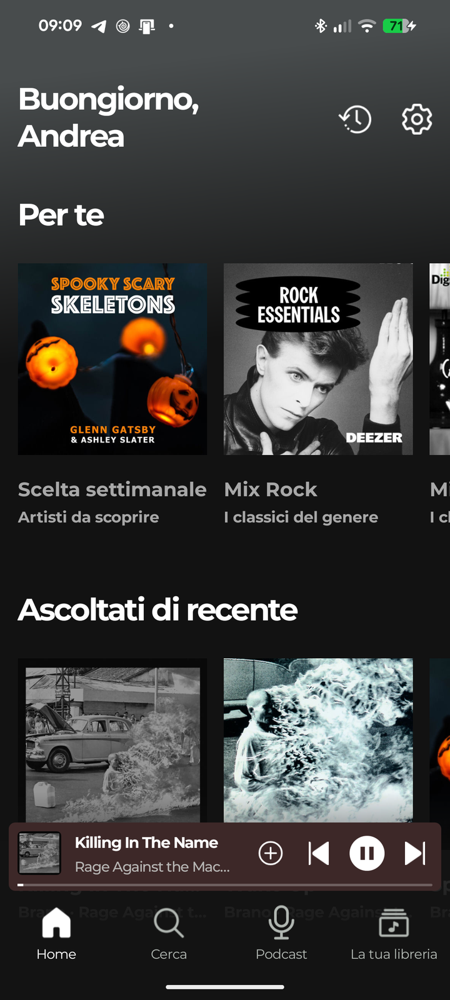
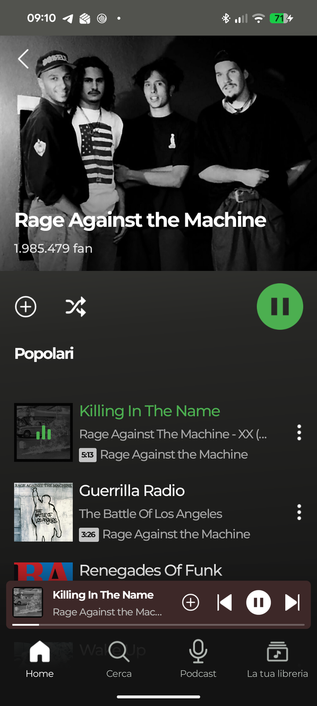
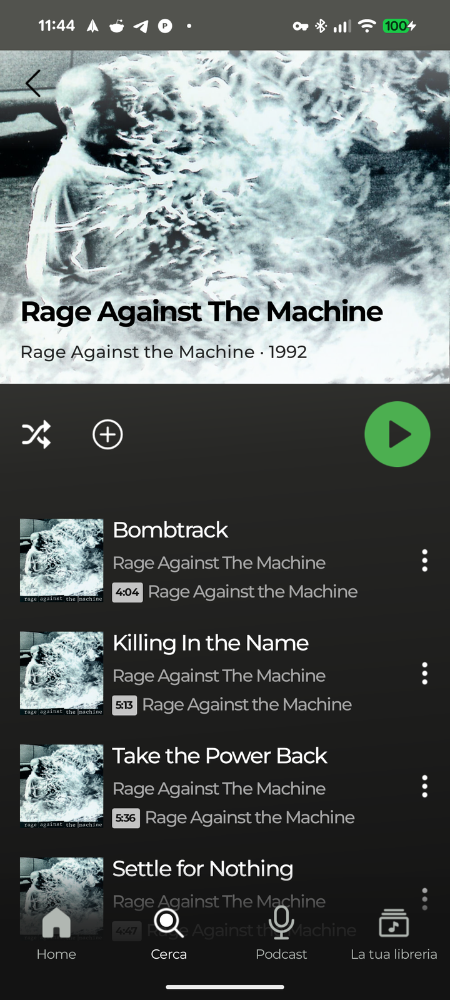
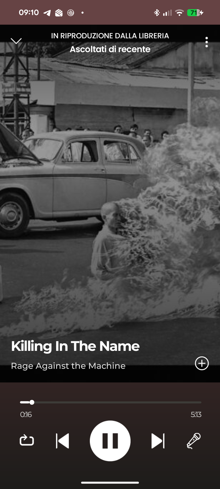
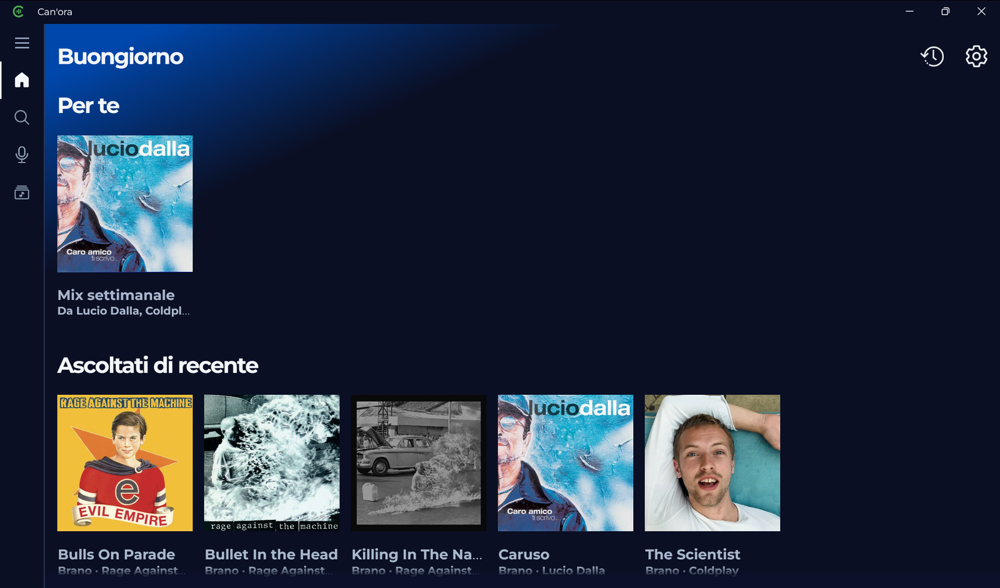
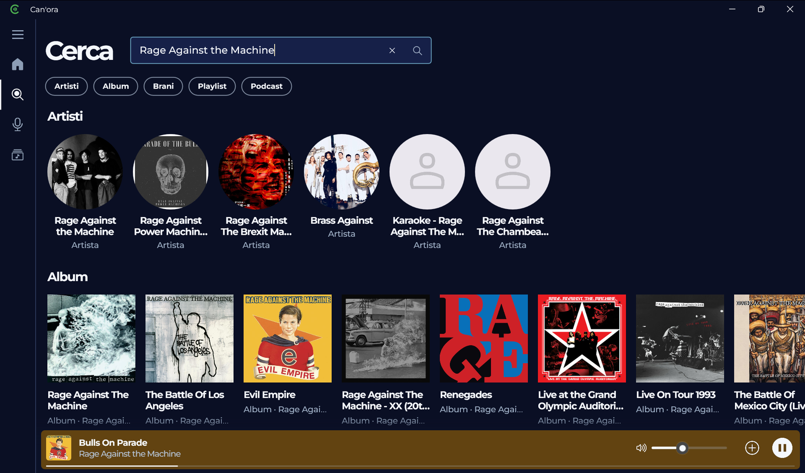
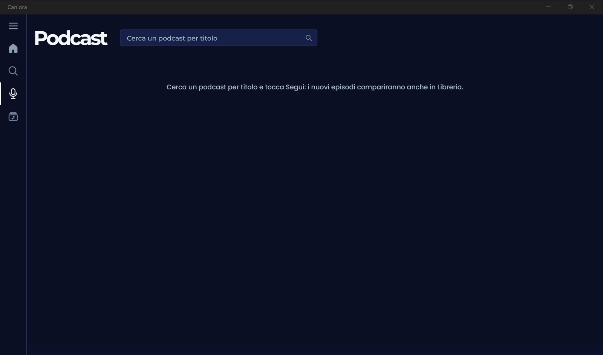
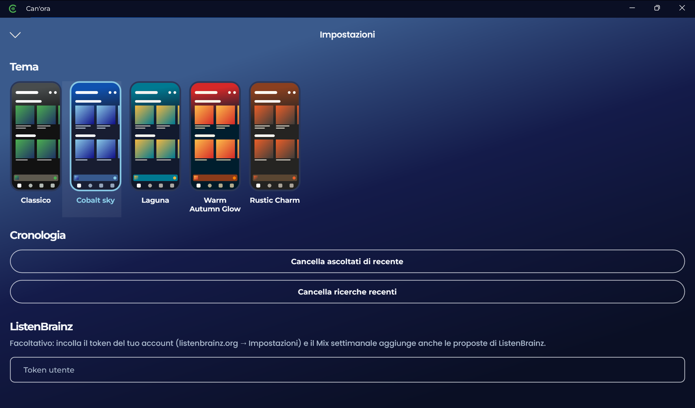

<p align="center">
	
</p>

<h1 align="center">Can'ora</h1>

<p align="center">
	A Spotify-style music and podcast player for Android and Windows, built with .NET MAUI.<br>
	Un player di musica e podcast in stile Spotify per Android e Windows, scritto in .NET MAUI.
</p>

<p align="center">
	<a href="#english">English</a> · <a href="#italiano">Italiano</a>
</p>

## Screenshots

### Android

| Home | Artist · Artista | Album | Now playing · In riproduzione |
| :---: | :---: | :---: | :---: |
|  |  |  |  |

### Windows

| Home | Search · Cerca |
| :---: | :---: |
|  |  |
| **Podcasts · Podcast** | **Settings and themes · Impostazioni e temi** |
|  |  |

---

## English

Can'ora is a personal project: a music player that looks and feels like Spotify, with no account to create. You search
the catalog, open artist and album pages, build your playlists, sing along with synced lyrics and follow podcasts.

The catalog (artists, albums, covers, charts) comes from Deezer's public API. The audio is streamed from YouTube: for
each track the app picks the video with the same length.

The interface is in Italian. The name comes from *canora*, Italian for "melodious" (as in *voce canora*, a tuneful
voice).

### Features

- **Search** for artists, albums, tracks, playlists and podcasts, with recent searches and genre tiles to browse.
- **Artist pages** with top tracks, albums and singles. **Album and playlist pages** with play all and shuffle.
- **Home** that greets you and suggests music: a *weekly pick* of new tracks from the radios of the artists you listen
  to most (plus ListenBrainz suggestions if you add your token), *genre mixes* and *recently played*.
- **Library** with your playlists and the podcasts you follow, stored on the device (SQLite).
- **Now playing** colored after the cover art, with repeat (all or one) and **karaoke**: synced lyrics from LRCLIB.
  Tap a line to jump there; the padlock keeps the screen on while you sing.
- **Podcasts**: search by title, follow a show and its new episodes appear in the Library. Playback resumes where you
  left off, with 15-second skips back and forward.
- **First-run setup**: your name, favorite genres and artists, so the suggestions work from day one.
- **Five themes**: Classic, Cobalt Sky, Laguna, Warm Autumn Glow and Rustic Charm.
- **Android**: background playback with the media notification. Voice commands from the phone assistant through
  Android 16 AppFunctions (experimental), such as *"Riproduci &lt;song&gt; da Can'ora"*.
- **Windows**: a plain unpackaged `.exe`, sidebar navigation, previous / play-pause / next buttons in the taskbar
  thumbnail, horizontal lists you can drag with the mouse.

### Under the hood

- .NET 11 MAUI: one project for Android and Windows, CoreCLR, XAML source generation and compiled bindings.
- [CommunityToolkit.Mvvm](https://github.com/CommunityToolkit/dotnet), [CommunityToolkit.Maui](https://github.com/CommunityToolkit/Maui)
  (MediaElement for playback).
- [YoutubeExplode](https://github.com/Tyrrrz/YoutubeExplode) for YouTube search and audio streams.
- [sqlite-net-pcl](https://github.com/praeclarum/sqlite-net) for playlists, recently played and listening history.
- [Shiny.AppFunctions](https://github.com/shinyorg/shiny) for the assistant commands on Android.
- Free web services with no API key: [Deezer API](https://developers.deezer.com/api) (catalog),
  [LRCLIB](https://lrclib.net) (lyrics), [iTunes Search API](https://performance-partners.apple.com/search-api)
  (podcasts), [ListenBrainz](https://listenbrainz.org) and [Cover Art Archive](https://coverartarchive.org) (optional
  suggestions).

### Build

You need the .NET 11 SDK (currently a release candidate) and the MAUI workloads:

```bash
dotnet workload install maui-android maui-windows
```

Android 8.0 (API 26) or later, on a connected device or an emulator:

```bash
dotnet build Canora/Canora.csproj -f net11.0-android -t:Run
```

Windows 10 version 1809 or later (the Windows target is built only on Windows):

```bash
dotnet build Canora/Canora.csproj -f net11.0-windows10.0.19041.0
```

The app is `Canora/bin/Debug/net11.0-windows10.0.19041.0/win-x64/Canora.exe`. You can also open `Canora/Canora.slnx`
in Visual Studio.

### Project layout

```
Canora/                 the .NET MAUI app
	Views/              pages
	ViewModels/
	Services/           catalog, YouTube matching, lyrics, podcasts, local database
	Controls/           reusable views (cards, rows, popups)
	Platforms/          Android and Windows specific code
	Resources/          themes, fonts, icons
docs/screenshots/       the images of this README
```

### Disclaimer

Can'ora is a personal, non-commercial project. It is not affiliated with Spotify, Deezer, YouTube, Apple or
ListenBrainz. The audio comes from YouTube through YoutubeExplode, which may conflict with YouTube's Terms of Service:
use it at your own risk. Cover art and artist photos in the screenshots belong to their owners.

---

## Italiano

Can'ora è un progetto personale: un player musicale che ha l'aspetto e l'uso di Spotify, senza account da creare. Cerchi
nel catalogo, apri le pagine di artisti e album, ti fai le tue playlist, canti con i testi sincronizzati e segui i
podcast.

Il catalogo (artisti, album, copertine, classifiche) arriva dall'API pubblica di Deezer. L'audio arriva da YouTube: per
ogni brano l'app sceglie il video con la stessa durata.

L'interfaccia è in italiano. Il nome viene da *canora*, come in *voce canora*.

### Funzionalità

- **Ricerca** di artisti, album, brani, playlist e podcast, con le ricerche recenti e le tile dei generi da sfogliare.
- **Pagine artista** con i brani più ascoltati, gli album e i singoli. **Pagine di album e playlist** con riproduci tutto
  e casuale.
- **Home** che ti saluta e ti propone musica: la *scelta settimanale* di brani nuovi dalle radio degli artisti che ascolti
  di più (più le proposte di ListenBrainz, se aggiungi il tuo token), i *mix per genere* e gli *ascoltati di recente*.
- **Libreria** con le tue playlist e i podcast che segui, salvati sul dispositivo (SQLite).
- **Player** colorato come la copertina, con ripeti (tutto o un brano) e **karaoke**: testi sincronizzati da LRCLIB.
  Tocchi una riga e il brano riparte da lì; con il lucchetto lo schermo resta acceso mentre canti.
- **Podcast**: cerchi per titolo, segui un programma e i nuovi episodi compaiono in Libreria. L'ascolto riprende da dove
  eri rimasto, con salti di 15 secondi avanti e indietro.
- **Presentazione al primo avvio**: il tuo nome, i generi e gli artisti preferiti, così le proposte funzionano da subito.
- **Cinque temi**: Classico, Cobalt Sky, Laguna, Warm Autumn Glow e Rustic Charm.
- **Android**: riproduzione in background con la notifica multimediale. Comandi vocali dall'assistente del telefono con
  le AppFunctions di Android 16 (sperimentali), per esempio *"Riproduci &lt;brano&gt; da Can'ora"*.
- **Windows**: un semplice `.exe` non pacchettizzato, navigazione con la barra laterale, pulsanti precedente /
  play-pausa / successivo nell'anteprima della taskbar, liste orizzontali da trascinare con il mouse.

### Com'è fatta

- .NET 11 MAUI: un solo progetto per Android e Windows, CoreCLR, XAML generato a build time e binding compilati.
- [CommunityToolkit.Mvvm](https://github.com/CommunityToolkit/dotnet), [CommunityToolkit.Maui](https://github.com/CommunityToolkit/Maui)
  (MediaElement per la riproduzione).
- [YoutubeExplode](https://github.com/Tyrrrz/YoutubeExplode) per la ricerca su YouTube e gli stream audio.
- [sqlite-net-pcl](https://github.com/praeclarum/sqlite-net) per playlist, ascoltati di recente e cronologia degli ascolti.
- [Shiny.AppFunctions](https://github.com/shinyorg/shiny) per i comandi dell'assistente su Android.
- Servizi web gratuiti e senza chiave: [Deezer API](https://developers.deezer.com/api) (catalogo),
  [LRCLIB](https://lrclib.net) (testi), [iTunes Search API](https://performance-partners.apple.com/search-api)
  (podcast), [ListenBrainz](https://listenbrainz.org) e [Cover Art Archive](https://coverartarchive.org) (proposte,
  facoltativi).

### Compilare

Servono l'SDK di .NET 11 (per ora una release candidate) e i workload MAUI:

```bash
dotnet workload install maui-android maui-windows
```

Android 8.0 (API 26) o successivo, su un dispositivo collegato o un emulatore:

```bash
dotnet build Canora/Canora.csproj -f net11.0-android -t:Run
```

Windows 10 versione 1809 o successiva (il target Windows si compila solo su Windows):

```bash
dotnet build Canora/Canora.csproj -f net11.0-windows10.0.19041.0
```

L'app è `Canora/bin/Debug/net11.0-windows10.0.19041.0/win-x64/Canora.exe`. In alternativa apri `Canora/Canora.slnx` in
Visual Studio.

### Struttura

```
Canora/                 l'app .NET MAUI
	Views/              pagine
	ViewModels/
	Services/           catalogo, abbinamento con YouTube, testi, podcast, database locale
	Controls/           viste riusabili (card, righe, popup)
	Platforms/          codice specifico di Android e Windows
	Resources/          temi, font, icone
docs/screenshots/       le immagini di questo README
```

### Avvertenze

Can'ora è un progetto personale e non commerciale. Non è affiliato a Spotify, Deezer, YouTube, Apple o ListenBrainz.
L'audio arriva da YouTube tramite YoutubeExplode, e questo può essere in contrasto con i Termini di servizio di YouTube:
usala a tuo rischio. Copertine e foto degli artisti negli screenshot appartengono ai rispettivi proprietari.
